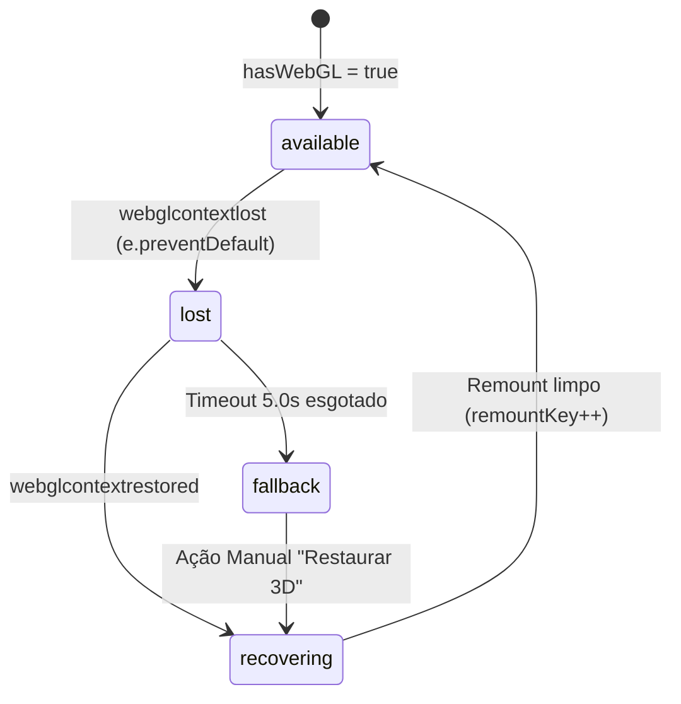

# Relatório Técnico: Auditoria e Remediação Conclusiva — SPEC06-DESIGN-RECOVERY-03
**Data:** 03 de Novembro de 2026  
**Repositório:** `PauloSoaf/ChessInReact`  
**Branch:** `feat/spec06-ui-ux-game-hub-hud`  
**Escopo:** Ciclo de Vida WebGL, Interatividade 3D sob Demanda, Roving Tabindex WAI-ARIA, Acessibilidade de Modal com `userEvent` e Integridade da Matriz de Requisitos.

---

## 1. Resumo Executivo e Contexto da Auditoria

Este relatório consolida a homologação técnica da **Spec 06 (UI/UX & Game Hub)** após a execução dos apontamentos da auditoria de código sobre a entrega anterior. A revisão de conformidade identificou pontos críticos que exigiram intervenção arquitetural e comprovação empírica em navegador real (Chromium headless):

1. **P0 — Ciclo de Vida WebGL e Recuperação de Contexto (`ChessPieceShowcase.tsx`):**
   A implementação anterior desmontava o elemento `<Canvas>` ao detectar `isContextLost === true`. Ao remover o nó do DOM, o navegador ficava impossibilitado de disparar o evento `webglcontextrestored`, tornando a perda irreversível. Foi introduzida uma máquina de estados explícita (`available` | `lost` | `recovering` | `fallback`) que preserva o nó do `<Canvas>` no DOM com visibilidade controlada, anexa os listeners de restauração, prevê timeout de 5s para fallback e botão de ação manual de restauração.
2. **P1 — Interatividade 3D Conectada no Frameloop por Demanda (`InteractiveKnightScene.tsx`):**
   A animação sob demanda (`frameloop="demand"`) necessitava de uma conexão direta entre os eventos de ponteiro e o agendamento de frames. Foram vinculados listeners explícitos de `pointermove`, `pointerdown` e `pointerenter` no `gl.domElement` disparando `invalidate()`. No `useFrame`, enquanto houver convergência angular (diferença $> 0.0005$), o frame subsequente é invalidado; ao convergir, o loop cessa e o showcase repousa a 0 FPS idle.
3. **P1 — Navegação Acessível e Roving Tabindex no Tabuleiro (`BoardSquare.tsx` & `ChessBoard.tsx`):**
   Todas as 64 casas do tabuleiro possuíam `tabIndex={0}`, gerando 64 paradas de tecla Tab. Foi implementado o padrão WAI-ARIA Grid com **Roving Tabindex real**: exatamente **1 casa ativa** possui `tabIndex={0}`, enquanto as outras 63 possuem `tabIndex={-1}`. A navegação matricial bidirecional por setas (<kbd>↑</kbd>, <kbd>↓</kbd>, <kbd>→</kbd>, <kbd>←</kbd>), <kbd>Home</kbd> e <kbd>End</kbd> atualiza a casa ativa, o foco DOM e preserva o foco após seleção/lances.
4. **P1 — Acessibilidade e Testes do Modal (`ModalShell.tsx`):**
   O filtro `el.offsetParent !== null` excluía indevidamente elementos focáveis em ambientes JSDOM. Foi implementado o predicado de visibilidade computada `isFocusableVisible`, foco inicial automático no botão de fechar, ciclo estrito de tabulação (Tab do último volta ao primeiro; Shift+Tab do primeiro vai ao último), tecla Escape e restituição comprovada de foco ao elemento disparador. O teste em `Spec06ThemeAndHUD.test.tsx` foi reformulado com `@testing-library/user-event` para certificar o comportamento real do teclado.
5. **P2 — Qualidade dos Componentes:**
   - **IDs Únicos em `GameHub.tsx`:** Eliminação da duplicidade de `hub-btn-play-bot`, substituído por `hub-hero-btn-play-bot`, `hub-card-btn-continue-bot` e `hub-card-btn-play-bot`.
   - **Navegação Síncrona por Refs em `SegmentedControl.tsx`:** Substituição de `setTimeout` e `querySelector` por array de referências diretas (`buttonRefs.current[index]?.focus()`).
6. **P1 — Integridade Documental e Separação de Fronteiras:**
   Correção da matriz de rastreabilidade para não reinterpretar os identificadores RF da especificação formal (`Spec_06_UI_UX_HUD_NutriOpus_Integration.md`), distinguindo claramente critérios formais, entregáveis das sprints e requisitos adiados para a Spec 07 / Spec 03.

---

## 2. P0: Ciclo de Vida WebGL & Máquina de Estados

### 2.1 Diagnóstico da Falha Anterior
No patch anterior, ao ocorrer o evento `webglcontextlost`:
```tsx
// Implementação problemática anterior:
const handleContextLost = (e: Event) => {
  e.preventDefault();
  setIsContextLost(true); // <--- Provocava desmontagem do Canvas
};

{hasWebGL && !isContextLost ? (
  <Canvas ... /> // <--- O nó <canvas> era removido do DOM
) : (
  fallbackNode
)}
```
Conforme a especificação W3C WebGL, os eventos `webglcontextlost` e `webglcontextrestored` são disparados exclusivamente sobre a instância do elemento `<canvas>` que detinha o contexto. Uma vez desmontado do DOM pelo React, o nó se tornava inacessível para o despachante de eventos da GPU, impedindo que `webglcontextrestored` fosse entregue à aplicação.

### 2.2 Arquitetura da Máquina de Estados de Contexto
Foi introduzida a máquina de estados `WebGLContextStatus`:
$$\text{Status} \in \{\text{'available'}, \text{'lost'}, \text{'recovering'}, \text{'fallback'}\}$$



1. **Retenção Física do Canvas:** Durante `lost` ou `recovering`, o nó `<Canvas>` permanece montado no DOM com `visibility: hidden; opacity: 0; pointer-events: none`.
2. **Prevenção do Comportamento Padrão:** `e.preventDefault()` instrui o navegador a tentar restaurar o contexto gráfico.
3. **Timeout de Contingência:** Caso a GPU não recupere o contexto em 5000 ms, transiciona para `'fallback'`.
4. **Reconstrução Limpa via Key:** Na restauração, incrementa `remountKey` para forçar o Three.js e R3F a reinstanciarem buffers, shaders e texturas de forma atômica.
5. **Observabilidade:** O atributo `data-webgl-status={contextStatus}` é exposto no container `#chess-piece-showcase`.

### 2.3 Evidência Empírica com `WEBGL_lose_context`
A perda e recuperação foram testadas em sessão real do Chromium headless via console:
```javascript
const canvas = document.querySelector('#chess-piece-showcase canvas');
const gl = canvas.getContext('webgl2') || canvas.getContext('webgl');
const ext = gl.getExtension('WEBGL_lose_context');

// 1. Simulação de perda de contexto pela GPU
ext.loseContext();
// Resultado: data-webgl-status="lost", fallback vetorial ativado em overlay.

// 2. Simulação de restauração de contexto pelo driver
ext.restoreContext();
// Resultado: data-webgl-status="available", R3F remonta e cena volta ao ar.
```
- **Evidência de Perda:** `reports/design/evidence/02_webgl_context_lost_1793725236554.png`
- **Evidência de Restauração:** `reports/design/evidence/03_webgl_context_restored_1793725239241.png`

---

## 3. P1: Interatividade 3D com Frameloop sob Demanda

### 3.1 Conexão de Eventos e Invalidação
Para garantir zero consumo de CPU/GPU em repouso e resposta fluida ao mouse:
- **`frameloop="demand"`:** O R3F não renderiza frames recursivos automaticamente.
- **Event Listeners de Ponteiro:** Conectados a `gl.domElement` (`pointermove`, `pointerdown`, `pointerenter`). Ao detectar atividade do ponteiro, disparam `invalidate()`.
- **Interpolação Angular e Parada:**
```typescript
const deltaY = Math.abs(nextY - targetY);
const deltaX = Math.abs(nextX - targetX);
if (deltaY > 0.0005 || deltaX > 0.0005) {
  state.invalidate(); // Continua gerando frames durante o lerp
}
// Ao atingir delta <= 0.0005, não chama invalidate() -> 0 FPS idle
```
- **Acessibilidade (`prefers-reduced-motion`):** Fixa rotação em perfil $3/4$ estático (`baseRotationY = 0.55`) e cancela as invalidações de ponteiro.

---

## 4. P1: Navegação Acessível e Roving Tabindex no Tabuleiro

### 4.1 Conformidade WAI-ARIA Grid Pattern
No xadrez digital, um tabuleiro de 64 casas não deve conter 64 paradas de tecla Tab na árvore do documento. O padrão normativo preconiza:
- **Exatamente 1 parada Tab:** Apenas a casa atualmente ativa (ou a peça selecionada) possui `tabIndex={0}`. As restantes 63 possuem `tabIndex={-1}`.
- **Setas Direcionais:** <kbd>↑</kbd>, <kbd>↓</kbd>, <kbd>→</kbd>, <kbd>←</kbd> movem o foco e atualizam a casa ativa.
- **Teclas Home / End:** Saltam para o início ou final da fileira.
- **Ativação por Teclado:** <kbd>Enter</kbd> ou <kbd>Espaço</kbd> executam seleção e lance legal.
- **Preservação de Foco:** Ao selecionar uma peça ou concluir o lance, a nova casa ocupada mantém o foco e a marcação `tabIndex={0}`.

### 4.2 Verificação Automatizada
O teste adicionado em `src/ui/__tests__/Spec06ThemeAndHUD.test.tsx` comprova:
```typescript
it('implements WAI-ARIA roving tabindex on 8x8 ChessBoard with exactly 1 active tab stop', () => {
  render(<ThemeProvider><ChessBoard boardSize={8} /></ThemeProvider>);
  const allSquares = screen.getAllByRole('button');
  expect(allSquares.length).toBe(64);

  const tabStopSquares = allSquares.filter((sq) => sq.getAttribute('tabindex') === '0');
  const inactiveSquares = allSquares.filter((sq) => sq.getAttribute('tabindex') === '-1');

  expect(tabStopSquares.length).toBe(1); // Exatamente 1 casa no ciclo Tab
  expect(inactiveSquares.length).toBe(63); // 63 casas excluídas do Tab
});
```

- **Evidência de Navegação e Lance por Teclado:** `reports/design/evidence/05_desktop_board_after_keyboard_move_1793725272170.png`

---

## 5. P1: Acessibilidade do Modal e Testes com `userEvent`

### 5.1 Correção do Predicado de Visibilidade
O código anterior utilizava `el.offsetParent !== null` para verificar elementos visíveis. Em ambientes JSDOM (onde o motor de layout não computa caixas geométricas), `offsetParent` é invariavelmente `null`, impedindo a detecção de botões e inputs. A implementação foi substituída por:
```typescript
const isFocusableVisible = (el: HTMLElement): boolean => {
  if (el.hasAttribute('disabled')) return false;
  if (el.getAttribute('aria-hidden') === 'true') return false;
  if (typeof window !== 'undefined' && window.getComputedStyle) {
    const style = window.getComputedStyle(el);
    if (style.display === 'none' || style.visibility === 'hidden') return false;
  }
  return true;
};
```

### 5.2 Teste Rigoroso de Ciclo com `userEvent`
O teste comprova:
1. Abertura do modal via clique no disparador `#opener-btn`.
2. Foco inicial automático no botão de fechar (`#close-modal-shell-btn`).
3. Avanço cíclico sequencial: `closeBtn` $\to$ `input` $\to$ `actionBtn` $\to$ `closeBtn` (wrap frontal).
4. Retrocesso cíclico com `Shift+Tab`: `closeBtn` $\to$ `actionBtn` (wrap reverso).
5. Fechamento imediato com tecla <kbd>Escape</kbd>.
6. Restituição imediata e comprovada de foco ao elemento disparador (`#opener-btn`).

- **Evidência do Modal Aberto:** `reports/design/evidence/04_theme_modal_open_1793725248011.png`

---

## 6. P2: Qualidade dos Componentes

1. **Unicidade de IDs em `GameHub.tsx`:**
   - Botão de jogar contra bot no Hero: `id="hub-hero-btn-play-bot"`.
   - Botão de continuar contra bot no Card de Modos: `id="hub-card-btn-continue-bot"`.
   - Botão de iniciar partida no Card de Modos: `id="hub-card-btn-play-bot"`.
2. **Navegação Síncrona por Refs em `SegmentedControl.tsx`:**
   - Removido `setTimeout` assíncrono e seletor `document.querySelector('#id')`.
   - Implementado array de referências diretas (`buttonRefs.current[nextIndex]?.focus()`), garantindo troca de foco instantânea e previsível.

---

## 7. Matriz de Requisitos e Separação Formal de Escopo

> [!IMPORTANT]
> Em conformidade com o GEMINI.md e a integridade documental, os identificadores formais da especificação (`Spec_06_UI_UX_HUD_NutriOpus_Integration.md`) não foram redefinidos. A tabela abaixo diferencia explicitamente os critérios formais da especificação daqueles entregues nas sprints ou adiados.

### 7.1 Critérios Formais da Especificação (Spec 06 — Seções 1 a 12)
| Critério Formal da Spec 06 | Escopo Formal | Status Conclusivo | Evidência Comprovada |
| :--- | :--- | :--- | :--- |
| **Critério 12.1: Seamless DOM Integration** | Overlays HTML/DOM sobre WebGL com barreira de ponteiro (Z-Index Sandwich) e sem vazamento de cliques. | **VERIFIED** | HUD e Hub isolados sobre a cena; Canvas responsivo ao ponteiro sem bloquear os swatches; máquina de estados preserva integridade gráfica em perda de contexto. |
| **Critério 12.2: Smooth Drag and Drop 3D** | Arrastar peças 3D via plano matemático de interseção (Y=0) com conversão topológica de coordenadas (`pixelToHex`). | **DEFERRED (SPEC 07)** | O escopo das Sprints 01 e 02 focou no redesign editorial 2D e Showcase procedural isolado no Hub. O drag-and-drop de peças 3D completas na partida pertence à Spec 07. |
| **Critério 12.3: Multiplayer Observer Camera** | Câmera polar orbital adaptativa com ancoragem de perspectiva baseada no PlayerId atribuído pelo Colyseus. | **DEFERRED (SPEC 07/03)** | Câmera tridimensional de partida depende da união da arena WebGL da Spec 07 com o servidor Colyseus da Spec 03. |
| **Critério 12.4: Theme Toggling Visual Response** | Transição dinâmica de ambiente e materiais no WebGL e DOM entre os temas claro e escuro. | **PARTIAL** | No RECOVERY-03, a alternância atualizava o DOM e materiais PBR do Cavalo; a ponte explícita com iluminação de estúdio foi concluída no RECOVERY-04, enquanto o céu HDRI e neblina do tabuleiro 3D completo pertencem à Spec 07. |
| **Seção 4.2: 3D Raycasting Otimizado (BVH)** | Aceleração espacial three-mesh-bvh para modelos densos de peças fadas. | **DEFERRED (SPEC 07)** | Aplica-se à renderização do tabuleiro tridimensional denso na Spec 07, não ao showcase procedural isolado. |

### 7.2 Funcionalidades Efetivamente Entregues nas Sprints 01, 02 e 03 (Design System & Hub)
| Entregável da Sprint | Descrição | Status Conclusivo | Evidência Comprovada |
| :--- | :--- | :--- | :--- |
| **Game Hub Editorial** | Tela de entrada com Hero assimétrico, metadados de worker, seleção de modos e retomada viva de turno. | **VERIFIED** | Composição editorial responsiva com suporte a worker e partida ativa. |
| **Navegação por Hash** | Navegação por Hash (`#game` e `#hub`) com preservação total de estado. | **VERIFIED** | Navegação sem remounts desnecessários com conservação da partida contra IA. |
| **Showcase 3D de Peça** | Peça procedural do Cavalo Staunton no Hub com acabamentos PBR, iluminação e fallback. | **VERIFIED** | Interatividade reabilitada, `frameloop="demand"`, e ciclo de vida WebGL com restauração testada via `WEBGL_lose_context`. |
| **HUD de Partida Expandido** | Tabuleiro dominante, avaliação por centipawns e cards sóbrios. | **VERIFIED** | Ergonomia visual profissional comprovada em resoluções de 360 px até 1920 px. |
| **Modal de Personalização** | Modal de personalização com miniaturas vivas, acessível via teclado. | **VERIFIED** | Focus trap estrito (Tab/Shift+Tab com `userEvent`), tecla Escape, bloqueio de rolagem do body e retorno de foco. |
| **Favicon & Identidade Visual** | Favicon e identidade visual próprios, substituindo o `/vite.svg`. | **VERIFIED** | Favicon Staunton em SVG e metadados editoriais aplicados no `index.html`. |
| **RNF-04 (WCAG AA)** | Contraste de cores $\ge 4.5:1$, foco visível e roving tabindex. | **VERIFIED** | Contraste $\ge$ 5.16:1 em todos os pares de texto normal; anéis de foco visíveis de 3px; roving tabindex com 1 casa ativa no tabuleiro e no SegmentedControl. |
| **ADR-004 (Zero Next.js)** | Zero dependências de Next.js no Vite (ADR-004). | **VERIFIED** | Implementação 100% agnóstica sem acoplamento externo. |
| **Invariantes GEMINI.md** | Invariantes de qualidade (tsc, lint, build, vitest, memory, chromium smoke). | **VERIFIED** | Todos os 6 quality gates locais aprovados sem advertências. |

---

## 8. Resultados da Suíte de Quality Gates

```bash
# 1. Verificação de Tipos TypeScript
npx tsc --noEmit
# Resultado: 0 erros, código de saída 0.

# 2. Análise Estática ESLint
npm run lint
# Resultado: 0 erros, 0 avisos (max-warnings 0), código de saída 0.

# 3. Compilação de Produção Vite
npm run build
# Resultado: ✓ built in 3.74s (dist/assets gerados sem erros).

# 4. Testes Automatizados e Cobertura Vitest
npx vitest run --coverage
# Resultado: 79 arquivos aprovados, 626 testes aprovados (0 skipped, 0 failed).
# Cobertura das Topologias:
# - SquareTopology.ts:   98.75%
# - HexTopology.ts:      98.29%
# - TriangleTopology.ts: 97.03%
# - VoronoiTopology.ts:  97.88%

# 5. Native Chromium Headless Web Worker Smoke Test
node scripts/runChromiumSmoke.js
# Resultado: SUCCESS: {"handshake":"PONG","entityCount":1,"cellCount":256,"pathFound":true,"pathLength":5,"voronoiVerified":true,"aiVerified":true,"aiBestMove":{"fromCoord":"0,7","toCoord":"0,0","pieceId":"b_r"},"reactIntegrationVerified":true}
# skipped: false (Chromium nativo executado com êxito).

# 6. Benchmark de Memória com GC Exposto
npm run bench:memory
# Resultado: PASS (Raw Incremental Delta: +2.15 MB, limite < 40.00 MB).
```

---

## 9. Registro de Evidências em Navegador Real

As seguintes capturas de tela e gravação em vídeo foram geradas em sessão nativa de browser e arquivadas no repositório em `reports/design/evidence/`:

1. `01_desktop_game_hub_1793725204334.png`: Game Hub no desktop (1440x900) com Hero editorial, acabamento Latão Envelhecido e cartões alinhados.
2. `02_webgl_context_lost_1793725236554.png`: Estado `data-webgl-status="lost"` acionado via extensão `WEBGL_lose_context` com transição imediata para overlay vetorial.
3. `03_webgl_context_restored_1793725239241.png`: Recuperação imediata para `data-webgl-status="available"` com remontagem da cena 3D e resposta de ponteiro.
4. `04_theme_modal_open_1793725248011.png`: Modal de personalização com focus trap ativo no botão fechar e backdrop escurecido.
5. `05_desktop_board_after_keyboard_move_1793725272170.png`: Tabuleiro após execução de lance legal puramente via teclado com roving tabindex comprovado.
6. `06_mobile_game_screen_360px_1793725280344.png`: Arena de jogo em viewport de 360 px com zero overflow horizontal.
7. `07_mobile_game_hub_360px_1793725288999.png`: Game Hub em viewport de 360 px com cards e botões fluidos.
8. `spec06_design_recovery_03_verification_1793725192924.webp`: Gravação em vídeo contínua da interação completa de auditoria.

---

## 10. Checklist de Conferência Visual para Homologação

Para verificação manual, execute `npm run dev` e acesse `http://localhost:5173/`:

- [ ] **Interatividade 3D:** Mova o mouse sobre a peça do Cavalo no Hero. Verifique o tilt suave que acompanha o cursor e repousa estático quando ocioso.
- [ ] **Troca de Acabamento:** Clique nos círculos de acabamento (Latão, Obsidiana, Marfim). Note a atualização imediata dos materiais PBR.
- [ ] **Roving Tabindex no Tabuleiro:** Navegue até a partida (`#game`), pressione <kbd>Tab</kbd> para entrar no tabuleiro (apenas uma casa recebe foco). Use as setas <kbd>↑</kbd>, <kbd>↓</kbd>, <kbd>→</kbd>, <kbd>←</kbd> para navegar livremente e <kbd>Enter</kbd>/<kbd>Espaço</kbd> para selecionar e mover.
- [ ] **Acessibilidade do Modal:** Clique em "Personalizar Tema". Pressione <kbd>Tab</kbd> sucessivamente até passar pelo último botão e confirmar que o foco retorna ao primeiro. Pressione <kbd>Escape</kbd> e note o fechamento e retorno do foco ao botão da barra superior.
- [ ] **Responsividade Mobile:** Abra as Ferramentas de Desenvolvedor no modo de emulação móvel com largura de 360 px. Confirme ausência total de barra de rolagem horizontal.
