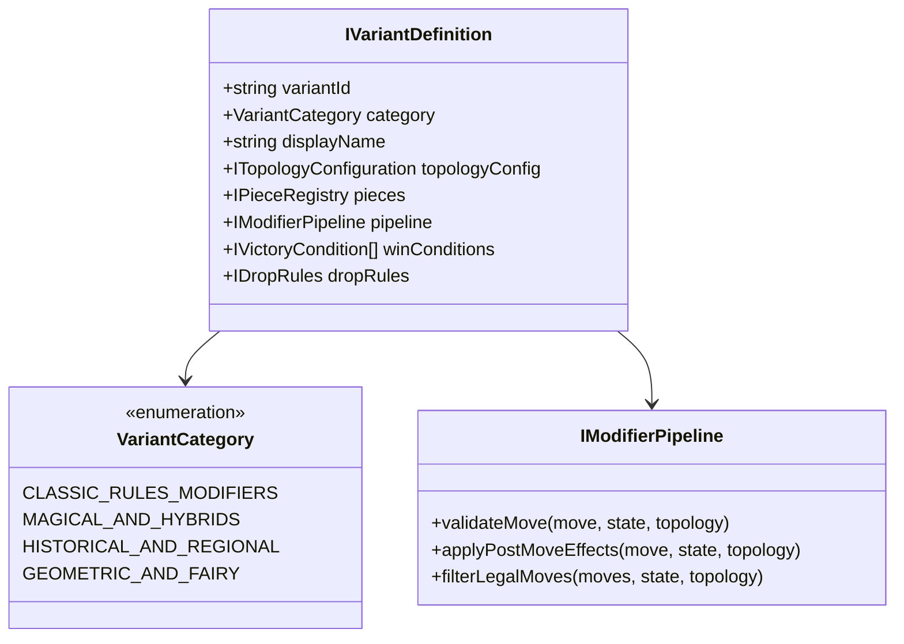

# Spec 13: Universo Expandido de Variantes, Motores Históricos, Peças Fadas e Modificadores (Parte 1/4)

## A. OBRIGAÇÃO DE DENSIDADE E ABORDAGEM
O ecossistema global do xadrez transcende amplamente a convenção ocidental de 64 casas estabelecida pela FIDE no século XIX. Plataformas de código aberto como **Lichess** e **PyChess**, ao lado do motor enciclopédico **Fairy-Stockfish**, comprovam a viabilidade matemática de unificar dezenas de modalidades sob uma mesma abstração algorítmica. O `ChessInReact` herda o núcleo desacoplado ECS (Spec 01) e o pipeline polimórfico de regras (Spec 04) para formalizar um **Universo Expandido de Variantes**, abrangendo modalidades clássicas de regras alteradas, modos mágicos e híbridos, xadrez histórico e regional (asiático, persa e cambojano) e tabuleiros com geometrias especiais e peças fadas (*Fairy Chess*).

Um princípio de governança fundamental é estabelecido nesta especificação: **Preservação de Integridade de Regras**. Modos que compartilham nomes ou temas similares, mas operam sob equilíbrios incompatíveis — como o **Spell Chess Oficial** (Chess.com: 2 feitiços fixos, Freeze e Jump, sem mana, recargas por turnos) e o **Spell Chess Expanded** (ChessInReact: 7 feitiços, economia de mana 2-6, cartas colecionáveis) — são categorizados e executados como **modos estritamente independentes**, impedindo contaminação de regras e preservando a fidelidade histórica e competitiva.

---

## 1. OBJETIVO DO SUBSISTEMA DE VARIANTES E REGRAS EXPANDIDAS
1. **Catalogação Exaustiva e Isomórfica:** Definir especificações formais de regras, condições de vitória, movimentação e serialização para 6 grandes famílias de xadrez:
   - **Família A:** Regras alternativas clássicas (Chess960, Three-Check, Five-Check, King of the Hill, Racing Kings, Horde, Antichess, Atomic, Crazyhouse, No Castling, Fog of War, Blindfold, Capture Anything, Torpedo, Sideways Pawns, Placement, Extinction, Kinglet, Three Kings).
   - **Família B:** Modos mágicos, especiais e híbridos (Spell Chess Oficial, Spell Chess Expanded, Duck Chess, Bughouse, Bughouse960, Crazyhouse960, Atomic960, Three-Check960, Capahouse, Grandhouse, S-House, Alice Chess, Chessgi, Knightmate, Maharajah and the Sepoys, Spell Chess Multiplayer, Atomic Crazyhouse, Duck Chess Multiplayer).
   - **Família D:** Tabuleiros geométricos e peças especiais (Gliński, McCooey, Chexs, Echexs, Toroidal, Cylindrical, Circular, Triangular, Voronoi, Infinite Procedural, Capablanca 10×8, Caparandom, Gothic, Grand Chess, Seirawan, Amazon, Janus, Omega, Shako, Shogun, Dragon, Hoppel-Poppel, Spartan, Orda, Fairy Chess Betza).
   - **Família E:** Variantes históricas e regionais (Chaturanga, Shatranj, Shogi, Minishogi, Kyoto Shogi, Tori Shogi, Dobutsu Shogi, Sho Shogi, Xiangqi, Minixiangqi, Janggi, Makruk, Makpong, Ouk Chaktrang, Sittuyin, ASEAN Chess, Shatar).
2. **Arquitetura de Modificadores Plugáveis:** Estender o padrão *Chain of Responsibility* da Spec 04 (`MovePipeline`), desacoplando regras em filtros atômicos (`AtomicExplosionModifier`, `AntichessForcedCaptureFilter`, `CheckCountTracker`, `CenterKingWinEvaluator`, `ExtinctionDetector`).
3. **Isomorfismo Cliente-Servidor:** Garantir que 100% dos motores de regras rodem em TypeScript puro sem dependências visuais, executando com idêntico determinismo no navegador (WebWorker) e no backend autoritativo (Colyseus).

---

## 2. ESCOPO DO SUBSISTEMA

### Pertence a esta Spec:
- Definição estrutural dos metadados de variante (`IVariantDefinition`, `IVariantRuleSet`).
- Implementação dos motores de regras para as Famílias A, B, D e E.
- Distinção formal e separação de contratos entre **Spell Chess Oficial** (2 feitiços) e **Spell Chess Expanded** (7 feitiços).
- Mapeamento de peças históricas para notação Betza generalizada (Generais, Elefantes, Canhões, Carruagens, Lanceiros).
- Lógica de promoção customizada por variante (ex: zonas de promoção no Shogi em 3 fileiras, promoção de peões em Makruk na 6ª fileira).
- Mecânicas de drops autoritativos com bolso de reservas (`Crazyhouse`, `Bughouse`, `Shogi`, `Capahouse`).
- Condições de término atípicas: Bare King (Shatranj), Extinção de classe, Mate triplo, Chegada de Rei ao centro ou oitava fileira.

### Não Pertence a esta Spec:
- Criação de Lobbies e filas de pareamento multiplayer (Ver Spec 08).
- Modelagem de arenas massivas de 3 a 12 jogadores (Ver Spec 14).
- Algoritmos de busca e poda de Inteligência Artificial para bots (Ver Spec 15).
- Componentes visuais do configurador de partidas e telas de seleção (Ver Spec 16).
- Shaders de renderização 3D e partículas WebGL (Ver Spec 07).

---

## 3. PESQUISA MATRIX: FONTES EXTERNAS E PROJETOS OPEN SOURCE VALIDADOS

### Fonte 1: "Fairy-Stockfish: Generalizes Chess Engines" (Fabian Fichter)
- **URL:** https://github.com/fairy-stockfish/Fairy-Stockfish
- **Problema Resolvido:** Como unificar centenas de variantes de xadrez em uma única representação de regras eficiente sem reescrever a engine do zero.
- **Conclusão Técnica:** O Fairy-Stockfish desacopla a representação das regras em arquivos de configuração declarativos (`variants.ini`), onde cada variante define: dimensões de tabuleiro, bolsos de drops, peças ativas, zonas de promoção e condições de vitória.
- **Decisão no ChessInReact:** Criaremos o `VariantConfigurationCatalog.ts`, um repositório declarativo fortemente tipado em TypeScript que define cada variante como uma composição imutável de modificadores, comportamentos de peças e condições de vitória.

### Fonte 2: "PyChess Variants Directory & Rules Implementation" (PyChess Community)
- **URL:** https://www.pychess.org/
- **Problema Resolvido:** Implementação de variantes históricas (Shogi, Xiangqi, Janggi, Makruk, Sittuyin) em ambiente Web com TypeScript e Python.
- **Conclusão Técnica:** Variantes asiáticas não são "peças ocidentais com skins". Elas exigem tabuleiros com rios (Xiangqi), palácios imperiais restritivos (Xiangqi/Janggi), peças que viram no reverso ao promover (Shogi), e regras estritas de repetição contínua proibida (*Perpetual Check rules*).
- **Decisão no ChessInReact:** Introdução de `TerritoryZoneConstraint` na topologia, permitindo definir "Palácio", "Rio" e "Zona de Promoção" como metadados geométricos nativos consumidos pela `RulesEngine`.

### Fonte 3: "Lichess Open Source Variants Architecture" (lichess-org/scalachess)
- **URL:** https://github.com/lichess-org/scalachess
- **Problema Resolvido:** Como lidar com Antichess (Giveaway), Atomic, King of the Hill, Three-Check e Racing Kings de forma hiper-otimizada.
- **Conclusão Técnica:** No Antichess, se qualquer captura existir no tabuleiro, todos os movimentos que não capturam são ilegais. No Atomic, capturas destroem a peça atacante, a capturada e todas as peças não-peões a 1 casa de raio.
- **Decisão no ChessInReact:** Reforço do pipeline `MovePipeline` com interceptores de pré-validação (`AntichessForcedCaptureInterceptor`) e pós-execução (`AtomicBlastRadiusInterceptor`).

### Fonte 4: "Chess.com Spell Chess Official Ruleset" (Chess.com Help & Fair Play)
- **URL:** https://support.chess.com/en/articles/8584280-what-is-spell-chess
- **Problema Resolvido:** Especificação autêntica do Spell Chess comercial.
- **Conclusão Técnica:** O jogador dispõe exclusivamente de 2 feitiços: **Freeze** (congela uma área de 3×3 casas por 1 turno completo; peças congeladas não podem se mover nem capturar) e **Jump** (permite que qualquer peça salte sobre outras como se fosse um cavalo). Não há sistema de Mana cumulativo nem cartas mágicas adicionais; os feitiços possuem cargas fixas e tempo de recarga (cooldown).
- **Decisão no ChessInReact:** Isolar estritamente `SPELL_CHESS_OFFICIAL` de `SPELL_CHESS_EXPANDED` no catálogo de variantes, impedindo conflito de design.

---

## 4. ARQUITETURA TÉCNICA E TAXONOMIA DE VARIANTES



### 4.1 Catálogo Detalhado das Famílias de Variantes

#### Família A: Xadrez Clássico & Modificadores de Regras
1. **`CHESS960` (Fischer Random):** Sorteio determinístico de 960 posições iniciais válidas respeitando: 2 bispos em casas de cores opostas e rei estritamente posicionado entre as duas torres para viabilizar roques em ambos os lados.
2. **`THREE_CHECK`:** Vitória clássica por xeque-mate ou por aplicar 3 xeques acumulados no rei adversário. Contador mantido no estado `metadata.checkCount[playerId]`.
3. **`FIVE_CHECK`:** Extensão tática do Three-Check exigindo 5 xeques acumulados para vitória imediata.
4. **`KING_OF_THE_HILL`:** Vitória por xeque-mate ou por posicionar o próprio rei nas 4 casas centrais canônicas (d4, e4, d5, e5).
5. **`RACING_KINGS`:** Ambos os reis começam na primeira fileira e correm em direção à oitava fileira. Xeques são estritamente proibidos em qualquer fase. Se as Brancas chegam à oitava fileira, as Pretas têm direito a 1 lance para empatar chegando também.
6. **`HORDE_CHESS`:** Exército branco assimétrico formado por 36 peões ocupando as fileiras 1 a 4 contra o exército negro tradicional. Pretas vencem eliminando todos os peões brancos; Brancas vencem por xeque-mate.
7. **`ANTICHESS` (Giveaway / Losing Chess):** O objetivo é perder todas as peças ou ficar sem movimentos legais (afogamento é vitória). Capturas são estritamente obrigatórias se disponíveis. Reis não possuem condição real; peões podem promover a rei.
8. **`ATOMIC_CHESS`:** Capturas geram uma explosão radial de raio 1 ($3\times 3$ casas). A peça agressora, a capturada e todas as peças adjacentes não-peões são removidas. Explodir o rei adversário concede vitória imediata. O próprio rei não pode capturar peças.
9. **`CRAZYHOUSE`:** Peças capturadas passam para o bolso de reservas (*drop reserve*) do jogador que realizou a captura, podendo ser reintroduzidas em qualquer casa vazia em turnos subsequentes (peões proibidos na 1ª e 8ª fileira).
10. **`NO_CASTLING`:** Regras convencionais com roque estritamente desabilitado para ambos os lados, fomentando ataques táticos ao rei no centro.
11. **`FOG_OF_WAR`:** Informação imperfeita. Cada jogador enxerga apenas as casas para as quais suas peças podem se mover ou atacar legitimamente no turno corrente. O rei pode ser capturado fisicamente; não existe aviso de xeque.
12. **`BLINDFOLD_CHESS`:** As peças são logicamente processadas e validadas pela engine, mas seus glifos/meshes visuais permanecem ocultos, exigindo visualização mental.
13. **`CAPTURE_ANYTHING`:** Jogadores podem capturar as próprias peças se taticamente vantajoso para abrir linhas de ataque ou liberar casas.
14. **`TORPEDO_CHESS`:** Peões mantêm a capacidade de avançar 2 casas em qualquer fileira do tabuleiro, e não apenas no lance inicial, acelerando as estruturas de peões.
15. **`SIDEWAYS_PAWNS`:** Peões ganham a habilidade adicional de mover-se 1 casa lateralmente (esquerda ou direita) para casas desocupadas, sem capturar.
16. **`EXTINCTION_CHESS`:** Vitória ao eliminar completamente todas as peças de qualquer uma das classes originais do adversário (todos os cavalos, todos os bispos, todas as torres, a dama ou o rei).

#### Família B: Modos Mágicos, Especiais e Híbridos
1. **`SPELL_CHESS_OFFICIAL` (Chess.com Standard):**
   - **Feitiços:** Apenas 2 feitiços disponíveis: `FREEZE` e `JUMP`.
   - **Economia:** Cargas pré-alocadas (2 Freezes, 2 Jumps por partida) com recarga obrigatória de 3 turnos entre usos. Sem mana cumulativo.
   - **Efeito Freeze:** Congela um quadrante $3\times 3$ por 1 turno do adversário.
   - **Efeito Jump:** Permite a uma peça ignorar peças intermediárias no seu movimento durante aquele lance.
2. **`SPELL_CHESS_EXPANDED` (ChessInReact Complete):**
   - **Feitiços (7):** `FREEZE`, `JUMP`, `INVISIBILITY`, `PORTAL_TELEPORT`, `SHIELD`, `TRAP`, `RESURRECTION`.
   - **Economia de Mana:** Inicia em 2 mana, regenera +1 por turno até o teto de 6 mana. Cada feitiço tem custo e cooldown específicos em cartas colecionáveis.
3. **`DUCK_CHESS`:**
   - Cada turno do jogador compõe-se obrigatoriamente de 2 fases atômicas:
     1. Movimento legal de uma peça do exército.
     2. Posicionamento do Pato Neutro (`DUCK`) em qualquer casa vazia do tabuleiro.
   - O Pato é neutro, impenetrável e não pode ser capturado. Não há xeque tradicional: reis podem ser capturados fisicamente.
4. **`BUGHOUSE` (2v2 Twin-Rooms):**
   - Disputa em duas mesas simultâneas (Mesa A: Brancas time 1 vs Pretas time 2; Mesa B: Brancas time 2 vs Pretas time 1).
   - Peça capturada na Mesa A transfere-se em $< 50\text{ms}$ para a reserva do parceiro na Mesa B.
   - Vitória compartilhada: o primeiro xeque-mate ou desistência em qualquer mesa encerra a partida para a dupla.
5. **`ALICE_CHESS`:**
   - A partida é jogada simultaneamente em 2 tabuleiros paralelos (A e B).
   - Toda peça que realiza um movimento no Tabuleiro A é automaticamente teleportada para a casa de coordenada idêntica no Tabuleiro B (desde que a casa de destino em B esteja desocupada).
6. **`KNIGHTMATE`:**
   - O Rei tradicional é substituído por um "Rei Cavalo" que se move como cavalo e possui a condição de realeza (`royal: true`). Os dois cavalos originais são substituídos por "Comuns" que se movem como reis, mas podem ser capturados normalmente.
7. **`MAHARAJAH_AND_SEPOYS`:**
   - Exército branco composto por apenas 1 única peça real super-poderosa: o *Maharajah* (combina movimentos de Dama e Cavalo, podendo teleportar ou saltar).
   - Exército negro com a formação completa padrão de 16 peças. Brancas vencem por xeque-mate; Pretas vencem capturando o Maharajah.

#### Família D: Tabuleiros Geométricos e Peças Fadas
1. **`GLINSKI_HEXAGONAL`:** Tabuleiro hexagonal regular com 91 casas hexagonais e 3 cores de casas. Bispos movem-se nas 6 diagonais verdadeiras; torres nas 6 arestas ortogonais; peões capturam em diagonais frontais.
2. **`CAPABLANCA_CHESS` (10×8):** Tabuleiro retangular de 80 casas introduzindo duas novas peças compostas:
   - **Arcebispo (Archbishop / Chancellor):** Movimenta-se como Cavalo + Bispo ($N + B$).
   - **Chanceler (Chancellor / Marshall):** Movimenta-se como Cavalo + Torre ($N + R$).
3. **`SEIRAWAN_CHESS`:** Xadrez tradicional com inclusão do **Falcão** ($B + N$) e do **Elefante** ($R + N$) mantidos em reserva, sendo introduzidos ("gating") no momento em que uma peça menor da primeira fileira é desenvolvida.
4. **`AMAZON_CHESS`:** Introdução da peça *Amazon* ($Q + N$), combinando os poderes de Dama e Cavalo.

#### Família E: Variantes Históricas e Regionais
1. **`CHATURANGA`:** O ancestral clássico indiano de 4 jogadores ou 2 jogadores, disputado sobre a grelha *Ashtāpada* de $8\times 8$ sem casas alternadas de cor. Peças: *Raja* (Rei), *Mantri* (Conselheiro, move 1 casa na diagonal), *Gaja* (Elefante, salta 2 casas diagonais), *Ashva* (Cavalo), *Ratha* (Carruagem/Torre), e *Padati* (Peão).
2. **`SHATRANJ`:** Xadrez persa pós-islâmico. Peças: *Shah* (Rei), *Fers* (Conselheiro, 1 casa diagonal), *Alfil* (Elefante, salta 2 casas diagonais), *Rukh* (Torre), *Asp* (Cavalo), *Baidaq* (Peão). Promoção exclusiva a Fers. Vitória por xeque-mate ou por desarmamento total do adversário (*Bare King*), desde que o jogador não seja desarmado no lance imediato seguinte.
3. **`SHOGI` (Xadrez Japonês 9×9):**
   - Tabuleiro de 81 casas com exércitos monocromáticos diferenciados pela direção do topo afunilado da peça.
   - **Reutilização Integral:** Todas as peças capturadas vão para o bolso de reservas do captor e podem ser reintroduzidas (*drop*) em qualquer casa vazia.
   - **Zona de Promoção:** As 3 fileiras mais distantes promovem peças (Ouro, Prata, Cavalo, Lanceiro, Bispo viram Cavalo-Dragão e Torre vira Rei-Dragão).
4. **`XIANGQI` (Xadrez Chinês 9×10):**
   - Peças posicionadas nas **interseções** das linhas (90 pontos).
   - Dividido pelo **Rio Celeste** entre as fileiras 4 e 5 (Elefantes não podem atravessar o rio; peões ganham movimento lateral ao cruzar).
   - **Palácio Imperial:** Quadrante de $3\times 3$ no qual o General (Rei) e os Guardas não podem sair.
   - **Canhão (Pao):** Move-se como Torre para casas vazias, mas para capturar exige saltar exatamente sobre uma peça intermediária (*screen*).
   - **Regra de Reis que se Olham:** Os generais opostos não podem se encontrar na mesma coluna aberta sem peças intermediárias.

---

## 5. ESTRUTURA DE DIRETÓRIOS E MÓDULOS

```text
src/
  engine/
    variants/
      catalog/
        VariantCatalog.ts             // Catálogo mestre unificado
        ClassicVariantsCatalog.ts     // Família A
        MagicalVariantsCatalog.ts     // Família B
        GeometricVariantsCatalog.ts   // Família D
        HistoricalVariantsCatalog.ts  // Família E
      interfaces/
        IVariantDefinition.ts         // Tipos de variantes e metadados
        IVariantRules.ts              // Regras e contratos de execução
      modifiers/
        AtomicExplosionModifier.ts    // Explosões radiais 3x3
        AntichessForcedCapture.ts     // Capturas forçadas
        ThreeCheckTracker.ts          // Contador de 3 e 5 xeques
        KingOfTheHillEvaluator.ts     // Vitória por ocupação central
        RacingKingsValidator.ts       // Corrida de reis sem xeque
        DuckPlacementModifier.ts      // Fase secundária do pato
        AliceBoardTeleportModifier.ts // Teleporte entre tabuleiros duplos
      historical/
        ShogiEngine.ts                // Motor de Shogi 9x9 e drops
        XiangqiEngine.ts              // Motor de Xiangqi com rio e canhão
        ShatranjEngine.ts             // Motor de Shatranj e Bare King
        MakrukEngine.ts               // Motor tailandês de Makruk
      spells/
        OfficialSpellEngine.ts        // Freeze e Jump (regras oficiais)
        ExpandedSpellEngine.ts        // 7 feitiços, deck e economia de mana
```

---

## 6. CONTRATOS DE DADOS E INTERFACES TYPESCRIPT

```typescript
// src/engine/variants/interfaces/IVariantDefinition.ts

export type VariantFamily =
  | 'CLASSIC_MODIFIERS'
  | 'MAGICAL_HYBRIDS'
  | 'GEOMETRIC_FAIRY'
  | 'HISTORICAL_REGIONAL'
  | 'MASSIVE_MULTIPLAYER';

export interface IVariantDefinition {
  readonly id: string;
  readonly name: string;
  readonly family: VariantFamily;
  readonly description: string;
  readonly badge: string;
  readonly initialFen?: string;
  readonly boardDimensions: { width: number; height: number };
  readonly topologyType: 'SQUARE' | 'HEXAGONAL' | 'TRIANGULAR' | 'TOROIDAL' | 'CYLINDRICAL';
  readonly maxPlayers: number;
  readonly hasDrops: boolean;
  readonly hasSpells: boolean;
  readonly hasDuck: boolean;
  readonly hasFogOfWar: boolean;
  readonly victoryConditions: VictoryConditionType[];
  readonly specialRules: Record<string, unknown>;
}

export type VictoryConditionType =
  | 'CHECKMATE'
  | 'BARE_KING'
  | 'THREE_CHECKS'
  | 'FIVE_CHECKS'
  | 'KING_OF_THE_HILL'
  | 'RACING_KINGS_EIGHTH_RANK'
  | 'EXTINCTION_OF_PIECE_CLASS'
  | 'NO_LEGAL_MOVES_WINS' // Antichess
  | 'POINTS_THRESHOLD';
```

---

## 7. REQUISITOS DO SISTEMA

### 7.1 Requisitos Funcionais (RF)
- **RF-13-01:** O sistema DEVE fornecer o catálogo completo categorizado das Famílias A, B, D e E com tipagem estrita e metadados descritivos.
- **RF-13-02:** O sistema DEVE suportar `SPELL_CHESS_OFFICIAL` com exatamente 2 feitiços (Freeze e Jump), recarga por turnos e sem economia de mana.
- **RF-13-03:** O sistema DEVE suportar `SPELL_CHESS_EXPANDED` como modo independente com 7 feitiços, curva de mana 2-6 e cartas colecionáveis.
- **RF-13-04:** O sistema DEVE implementar o motor de `DUCK_CHESS` com resolução estrita em duas fases atômicas (lance de peça + posicionamento neutro do pato).
- **RF-13-05:** O sistema DEVE implementar o motor de `ATOMIC_CHESS` com detonação em raio 1 para capturas e eliminação instantânea na explosão do rei.
- **RF-13-06:** O sistema DEVE implementar o motor de `ANTICHESS` com obrigação algorítmica de captura e vitória por aniquilação completa ou afogamento.
- **RF-13-07:** O sistema DEVE implementar o motor de `THREE_CHECK` e `FIVE_CHECK` com contagem incremental imutável de xeques no estado da partida.
- **RF-13-08:** O sistema DEVE implementar o motor de `KING_OF_THE_HILL` avaliando a vitória no instante em que um rei alcança o quadrado central (d4, e4, d5, e5).
- **RF-13-09:** O sistema DEVE implementar o motor de `RACING_KINGS` com largada na 1ª fileira, proibição estrita de xeques e equalização de lance para Pretas.
- **RF-13-10:** O sistema DEVE implementar `CRAZYHOUSE` e `BUGHOUSE` com validação autoritativa de drops em casas vazias e restrição de peões nas bordas extremas.
- **RF-13-11:** O sistema DEVE fornecer motores históricos para `SHATRANJ` (Bare King, promoção a Fers), `SHOGI` (9×9, drops, promoção em 3 fileiras) e `XIANGQI` (Rio, Palácio e Canhão).
- **RF-13-12:** O sistema DEVE suportar tabuleiros ampliados `CAPABLANCA_CHESS` (10×8) com as peças compostas Chanceler ($R+N$) e Arcebispo ($B+N$).

### 7.2 Requisitos Não-Funcionais (RNF)
- **RNF-13-01 (Isomorfismo Zero-DOM):** Todos os módulos de variantes DEVEM ser desacoplados de bibliotecas React e WebGL, executando em Node.js e WebWorkers.
- **RNF-13-02 (Desempenho de Validação):** A geração e validação de movimentos legais de qualquer variante NÃO PODE exceder $1.5\text{ ms}$ em CPU de referência.
- **RNF-13-03 (Determinismo de Estado):** O avanço de estado em qualquer variante DEVE ser 100% determinístico e reproduzível a partir do log linear de ações.

---

## 8. CRITÉRIOS DE ACEITE E TESTES HOMOLOGATÓRIOS
1. **Spell Chess Dual Integrity:** Teste automatizado confirma que uma tentativa de gastar mana no `SPELL_CHESS_OFFICIAL` lança erro de contrato; confirma que o `SPELL_CHESS_EXPANDED` permite os 7 feitiços com mana.
2. **Duck Chess Invariant:** Teste automatizado confirma que o turno não é completado sem o posicionamento do pato, e que nenhuma peça de qualquer cor pode atravessar ou capturar a casa ocupada pelo pato.
3. **Atomic Chess Blast Verification:** Teste automatizado confirma que uma captura em e4 elimina a peça capturada, o agressor e peças adjacentes não-peões em raio 1, preservando peões adjacentes conforme a regra oficial.
4. **Antichess Mandatory Capture:** Teste automatizado comprova que se houver 1 captura legal, movimentos calmos retornam lista vazia de lances legais.
5. **Shogi Drop & Promotion:** Teste comprova que uma peça capturada pode ser inserida no tabuleiro e que atravessar a 7ª fileira ativa a flag de promoção.

