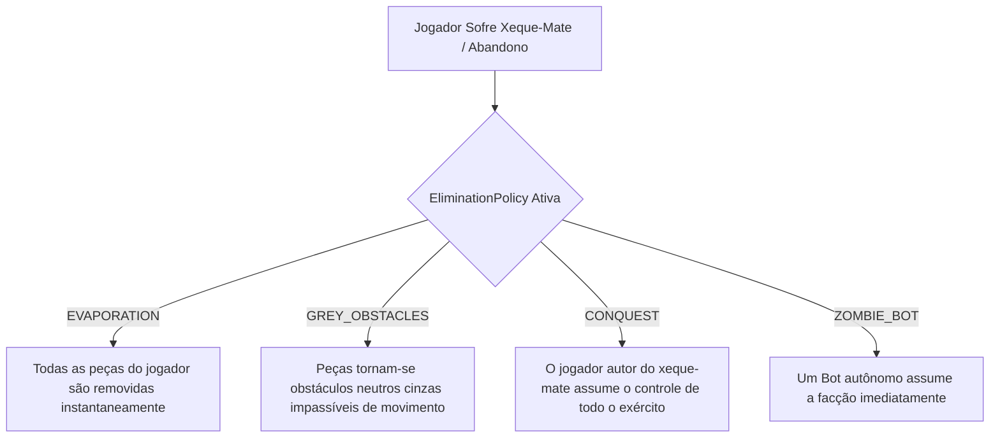
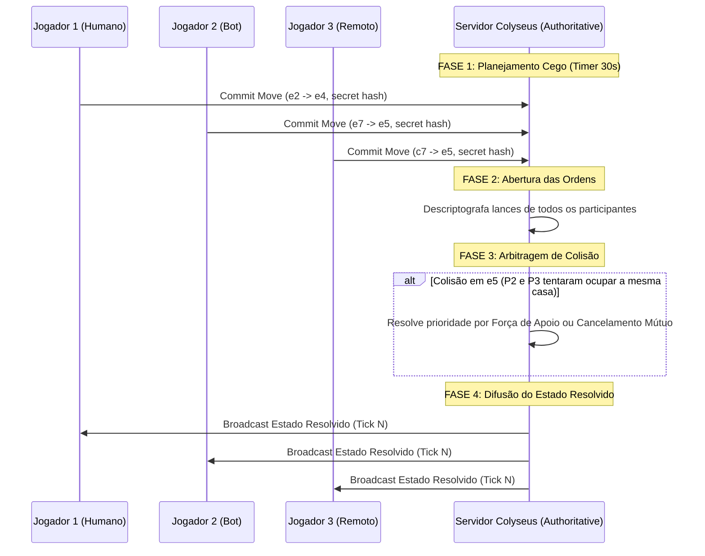

# Spec 14: Arenas Multijogador Massivas (3 a 12 Jogadores) e Resolução de Ações Simultâneas (Parte 1/4)

## A. OBRIGAÇÃO DE DENSIDADE E ABORDAGEM
Historicamente, o xadrez foi concebido como um duelo estrito de dois exércitos em soma-zero. Contudo, pesquisas recentes e plataformas especializadas como **4PlayerChess+** (com seu acervo de 34 tabuleiros para 2 a 12 jogadores), ao lado de variantes históricas como o *Chaturaji* de 4 facções e o *Diplomacy Chess* com turnos simultâneos e secretos, comprovam que o xadrez contemporâneo pode operar como um jogo de arena com múltiplos competidores independentes, alianças dinâmicas e disputas territoriais caóticas.

A transição de 2 para até 12 participantes quebra pressupostos fundamentais da engenharia tradicional de xadrez:
1. **Ordem de Turno:** Não há alternância binária (Brancas/Pretas). Pode haver rotação em sentido horário (*Clockwise*), leilão de iniciativa (*Initiative Bidding*) ou execução simultânea de ordens (*Simultaneous Resolution*).
2. **Eliminação de Facções:** O xeque-mate em um rei não encerra a partida para os outros 10 jogadores. É imperativo definir a destinação dos exércitos do jogador derrotado (evaporação, peças neutras cinzas estacionárias ou anexação pelo conquistador).
3. **Modelos de Pontuação e Vitória:** Diferenciação estrita entre **Todos Contra Todos (FFA - Free For All)**, **Modo Equipes (Teams 2v2, 3v3, 4v4)** e **Solo Ranqueado** (pontuação por sobrevivência e peças capturadas).

Esta especificação formaliza a arquitetura matemática, de rede e de regras para suportar **qualquer configuração de 3 a 12 participantes** no `ChessInReact`.

---

## 1. OBJETIVO DO SUBSISTEMA DE ARENAS MASSIVAS
1. **Catálogo de 18 Modalidades de 3 a 12 Jogadores:** Formalizar as geometrias de tabuleiros, distribuição inicial de exércitos e coordenadas de spawn para todos os formatos pesquisados.
2. **Motor Autoritativo de Colisão e Turno:** Processar ordens em salas Colyseus escaláveis (`MultiplayerArenaRoom`), suportando turnos rotativos e turnos secretos simultâneos (*Diplomacy Chess*).
3. **Mecânica de Herança de Peças na Eliminação:** Fornecer políticas configuráveis para o destino das peças de um jogador eliminado por xeque-mate ou abandono.
4. **Sincronização de Baixo Overhead:** Transmitir deltas compactados de até 12 jogadores em menos de $45\text{ ms}$ de latência com tolerância a quedas parciais de conexão.

---

## 2. ESCOPO DO SUBSISTEMA

### Pertence a esta Spec:
- Geometria e coordenadas de 18 arenas massivas (3 a 12 jogadores).
- Máquina de estados de ordem de turno multijogador (`TurnCycleManager`).
- Motor de resolução de turnos simultâneos e desempate determinístico de colisões.
- Sistema de pontuação competitiva FFA (capturas, xeques e eliminações).
- Protocolo de rede Colyseus para até 12 conexões concorrentes por sala com reconexão resiliente.

### Não Pertence a esta Spec:
- Criação de IAs e heurísticas de busca MaxN / Paranoid Search (Ver Spec 15).
- Interface visual de seleção de participantes e telas de lobby (Ver Spec 16).
- Validação Betza de peças customizadas individuais (Ver Spec 10 e Spec 13).
- Shaders de iluminação 3D e renderização de 12 câmeras orbitais (Ver Spec 07).

---

## 3. PESQUISA MATRIX: FONTES EXTERNAS E PROJETOS RELEVANTES

### Fonte 1: "4PlayerChess+ Architecture and 34 Board Layouts"
- **URL:** https://4playerchess.plus/
- **Problema Resolvido:** Como estruturar arenas de 2 a 12 jogadores com tabuleiros poligonais regulares e irregulares.
- **Conclusão Técnica:** Tabuleiros multijogador não são expansões quadradas simples de $8\times 8$. Eles utilizam um núcleo central (ex: $8\times 8$) com "asas" de exércitos projetadas nas bordas (ex: $8\times 3$ casas extras por facção), ou anéis concêntricos hexagonais e dodecagonais.
- **Decisão no ChessInReact:** O módulo de topologia estende a `CompositeTopology`, permitindo unir o núcleo central com N áreas de desdobramento radial.

### Fonte 2: "Four-Player Chess Official Rules & Scoring System" (Chess.com Help)
- **URL:** https://support.chess.com/en/articles/8584280-four-player-chess
- **Problema Resolvido:** Como pontuar e determinar o vencedor em partidas FFA de múltiplos participantes.
- **Conclusão Técnica:** No modo FFA, o vencedor é definido por pontos acumulados, não apenas por ser o último sobrevivente. Peão = 1 pt, Cavalo = 3 pts, Bispo = 3 pts, Torre = 5 pts, Dama = 9 pts, Xeque a múltiplos reis simultâneos = bônus cumulativo, Xeque-mate = 20 pts.
- **Decisão no ChessInReact:** O `FFAScoringEngine` rastreia a pontuação de cada facção em tempo real e emite eventos `SCORE_UPDATED` a cada lance.

### Fonte 3: "Diplomacy Game Engine: Simultaneous Move Resolution" (Allan B. Calhamer / WebDiplomacy)
- **URL:** https://webdiplomacy.net/
- **Problema Resolvido:** Como resolver ordens de múltiplos jogadores emitidas no mesmo segundo sem vantagem de latência de rede.
- **Conclusão Técnica:** Todos os jogadores submetem suas ordens de forma criptografada ou cega (*Commit Phase*). Ao esgotar o temporizador, o servidor abre todas as ordens e executa o *Arbitration Cycle*: se duas peças se movem para a mesma casa, aplica-se o critério de suporte de força ou cancelamento mútuo (ambas permanecem na origem).
- **Decisão no ChessInReact:** Implementação da classe `SimultaneousResolutionEngine` com algoritmo determinístico de arbitragem de colisões.

---

## 4. CATÁLOGO DAS 18 ARENAS MASSIVAS (3 A 12 JOGADORES)

| Identificador do Modo | Quantidade de Jogadores | Formato Geométrico | Modos de Disputa Suportados |
| :--- | :---: | :--- | :--- |
| **`THREE_PLAYER_CHESS`** | 3 | Hexagonal de 96 casas com 3 alas radiais | FFA, Solo |
| **`TRIANGULAR_CHAOS_3P`** | 3 | Grade triangular pura de 3 exércitos | FFA |
| **`FOUR_PLAYER_FFA`** | 4 | Cruz clássica com núcleo $8\times 8$ + 4 alas $8\times 3$ (160 casas) | FFA (Pontos) |
| **`FOUR_PLAYER_TEAMS`** | 4 | Tabuleiro de 4 jogadores em equipes | Duplas 2v2 (P1+P3 vs P2+P4) |
| **`FOUR_PLAYER_SOLO`** | 4 | Tabuleiro de 4 jogadores sem pontos de peças | Último Rei Sobrevivente |
| **`CHATURAJI`** | 4 | Tabuleiro $8\times 8$ com 4 cantos e dados/estratégia | Histórico FFA ou Duplas |
| **`FORTRESS_5P`** | 5 | Arena pentagonal com 1 facção no castelo central | 1 vs 4 ou FFA |
| **`STRONGHOLD_5P`** | 5 | Grade em estrela de 5 pontas | FFA |
| **`CITADEL_5P`** | 5 | Arena circular concêntrica de 5 participantes | FFA |
| **`HEXAGON_SIX_PLAYER`** | 6 | Hexágono ampliado com 6 exércitos perimetrais | FFA, Equipes 3v3 ou 2v2v2 |
| **`SIX_PLAYER_TEAMS`** | 6 | Arena hexagonal configurada para 3v3 | Equipes (Time Aliança vs Time Horda) |
| **`MINI_HEXAGON_6P`** | 6 | Arena compacta para partidas rápidas de 6 facções | Blitz FFA |
| **`SEVEN_PLAYER_FFA`** | 7 | Heptágono concêntrico com 7 exércitos independentes | FFA |
| **`OCTAGON_FFA`** | 8 | Octógono radial de 8 participantes | FFA |
| **`OCTAGON_TEAMS`** | 8 | Octógono configurado em 4v4 | Equipes Massivas |
| **`NEXUS_10P`** | 10 | Arena em anel duplo para 10 participantes | FFA, 5v5 |
| **`MINI_DODECAGON_12P`** | 12 | Dodecágono perimetral (capacidade máxima de 12 jogadores) | FFA, 6v6, 4v4v4 |
| **`DIPLOMACY_CHESS`** | 3 a 8 | Tabuleiro customizável com turnos simultâneos | Diplomacia e Traição |

---

## 5. REGRAS DE ELIMINAÇÃO E DESTINO DOS EXÉRCITOS

Quando um jogador sofre xeque-mate ou abandona a partida em uma arena de 3 a 12 jogadores, o servidor aplica a política configurada no lobby (`EliminationPolicy`):

1. **`EVAPORATION` (Padrão FFA):** Todas as peças restantes da facção eliminada são varridas do tabuleiro em um único tick, desobstruindo linhas de visão e ataque para os sobreviventes. O autor do mate recebe o bônus de 20 pontos.
2. **`GREY_OBSTACLES`:** As peças permanecem fisicamente no tabuleiro como obstáculos cinzas desativados. Não realizam ataques nem xeques, mas bloqueiam passagens até serem capturadas por qualquer participante.
3. **`CONQUEST` (Modo Conquista):** O jogador que aplicou o xeque-mate herda o comando de todas as peças sobreviventes do derrotado, dobrando seu poderio de fogo no próximo turno.
4. **`ZOMBIE_BOT` (Modo Resiliência):** Caso um jogador humano caia por timeout ou desconexão, um Bot calibrado assume imediatamente a facção, preservando a dinâmica estratégica da arena.

---

## 6. MOTOR DE TURNOS SIMULTÂNEOS (DIPLOMACY CHESS)

No modo `DIPLOMACY_CHESS`, os turnos não são sequenciais. O ciclo de execução opera em fases atômicas sincronizadas pelo servidor:

### Regras de Arbitragem de Colisão:
- **Movimentos Independentes:** Peças com destinos distintos e caminhos desimpedidos movem-se paralelamente sem interferência.
- **Colisão de Destino Duplo (Head-on Collision):** Se duas peças tentam ocupar a mesma casa no mesmo tick, nenhuma delas entra na casa; ambas sofrem *Bounce-back* e retornam à casa de origem sem penalidade.
- **Troca Frontal Impossível (Swap Collision):** Se a peça A tenta mover para a casa da peça B e a peça B tenta mover para a casa da peça A no mesmo turno, ambas colidem no meio do caminho e sofrem ricochete (*Bounce-back*).

---

## 7. REQUISITOS DO SISTEMA

### 7.1 Requisitos Funcionais (RF)
- **RF-14-01:** O sistema DEVE fornecer as topologias geométricas e posições iniciais de spawn para as 18 arenas massivas (3 a 12 participantes).
- **RF-14-02:** O sistema DEVE gerenciar o ciclo de turnos em sentido horário (*Clockwise*), pulando automaticamente facções já eliminadas.
- **RF-14-03:** O sistema DEVE implementar a política de pontuação `FFAScoringEngine`, computando pontos de material capturado e bônus de 20 pontos por eliminação.
- **RF-14-04:** O sistema DEVE suportar as 4 políticas de eliminação configuráveis (`EVAPORATION`, `GREY_OBSTACLES`, `CONQUEST`, `ZOMBIE_BOT`).
- **RF-14-05:** O sistema DEVE implementar o motor de turnos simultâneos `SimultaneousResolutionEngine` com fases de *Commit*, *Abertura* e *Arbitragem Determinística*.
- **RF-14-06:** O sistema DEVE suportar o modo Equipes (Teams) com vitória coletiva compartilhada no instante em que todas as equipes rivais forem eliminadas.
- **RF-14-07:** O sistema DEVE sincronizar deltas de rede para até 12 clientes em salas `MultiplayerArenaRoom` mantendo a taxa de atualização estável em 20 Hz.

### 7.2 Requisitos Não-Funcionais (RNF)
- **RNF-14-01 (Escalabilidade de Memória):** O estado da partida para uma arena de 12 jogadores com até 192 peças em campo NÃO PODE exceder $4.0\text{ MB}$ de consumo no heap da sala.
- **RNF-14-02 (Latência de Arbitragem):** O cálculo da fase de arbitragem de lances simultâneos NÃO PODE demorar mais de $10\text{ ms}$ para 12 ordens simultâneas.

---

## 8. CRITÉRIOS DE ACEITE E TESTES HOMOLOGATÓRIOS
1. **12-Player Layout Integrity:** Teste automatizado valida que a arena `MINI_DODECAGON_12P` monta 12 exércitos distintos em suas respectivas posições perimetrais sem sobreposição de coordenadas.
2. **Turn Rotation After Elimination:** Teste comprova que ao eliminar o Jogador 3 em uma partida de 6 jogadores, o turno do Jogador 2 avança diretamente para o Jogador 4.
3. **Simultaneous Head-on Bounce:** Teste de arbitragem comprova que duas peças tentando mover-se para a mesma casa no mesmo tick sofrem recuo para as posições de origem sem corrupção de estado.
4. **Scoring Tally Accuracy:** Teste comprova que capturar uma Dama adversária e aplicar xeque-mate acumula exatamente 29 pontos no placar individual da facção.
