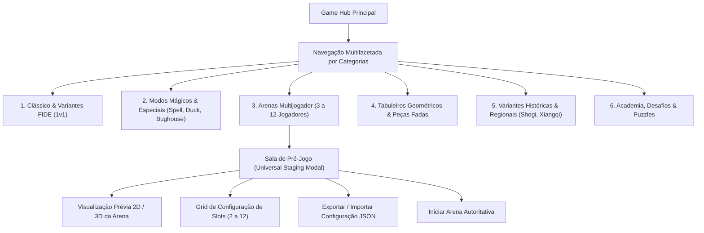

# Spec 16: Configurador Universal de Partidas, Gestão Dinâmica de Slots (2 a 12 Jogadores) e Game Hub Visual Expandido (Parte 1/4)

## A. OBRIGAÇÃO DE DENSIDADE E ABORDAGEM
Uma plataforma de xadrez que oferece mais de 70 modalidades, variantes com geometrias atípicas e arenas para até 12 participantes enfrenta um desafio crítico de experiência do usuário (UX): **Como evitar a sobrecarga cognitiva e garantir que qualquer combinação de participantes seja configurável de forma intuitiva, fluida e acessível?**

No modelo rudimentar anterior do `GameHub`, a seleção limitava-se a dois botões ("Partida vs Bot" e "Duelo Local") com chaveamento simplório. O `ChessInReact` transcende essa limitação ao introduzir dois pilares arquiteturais fundamentais:
1. **Contrato Universal de Participantes (Universal Participant Configuration):** Todo jogo, seja um duelo clássico de 2 jogadores, uma batalha mágica de Spell Chess ou uma arena massiva de 12 competidores, é parametrizado como uma coleção de **Slots Dinâmicos** (`slot[0..N-1]`). Cada slot pode ser atribuído individualmente como **Humano Local**, **Bot IA** (com dificuldade e estilo calibrados), **Humano Remoto** (via Colyseus) ou **Bot Substituto** (*Stand-in* para assumir conexões caídas).
2. **Game Hub Visual Expandido e Sala de Pré-Jogo:** Uma interface editorial nobre inspirada no design system da Spec 06, com navegação multifacetada pelas 6 grandes famílias de xadrez, pré-visualização interativa 2D/3D da arena e importação/exportação da configuração da partida em formato **JSON padronizado**.

---

## 1. OBJETIVO DO SUBSISTEMA DE CONFIGURAÇÃO E LOBBY
1. **Gestão Flexível de 2 a 12 Participantes:** Permitir configurações arbitrárias de humanos e bots (ex: 1 humano local + 5 bots; 2 humanos locais + 2 bots; 4 duplas de bots vs humanos remotos).
2. **Navegação Categórica e Facetada no Game Hub:** Organizar o catálogo em 6 abas principais com busca em tempo real, badges de mecânicas e filtros rápidos de jogadores (1v1, 2v2, FFA, 3 a 12P).
3. **Sala de Pré-Jogo com Pré-Visualização Tridimensional:** Exibir a geometria do tabuleiro, o posicionamento dos exércitos e as cores atribuídas antes de iniciar a partida.
4. **Portabilidade de Configuração (JSON Schema):** Permitir que organizadores de torneios e jogadores compartilhem setups de partida através de strings JSON intercambiáveis.

---

## 2. ESCOPO DO SUBSISTEMA

### Pertence a esta Spec:
- Esquema formal TypeScript e JSON Schema da configuração universal de partida (`IMatchConfiguration`).
- Máquina de estados da sala de pré-jogo (`PreMatchStagingController`).
- Mapeamento dinâmico de slots com papéis: `HUMAN_LOCAL`, `AI_BOT`, `HUMAN_REMOTE`, `BOT_STANDIN`.
- Interface e componentes do **Game Hub Visual Expandido** com 6 categorias.
- Sistema de exportação e importação de configurações de partida para a área de transferência (*Clipboard*).
- Gestão de tempo de reflexão individual e controles de relógio multijogador (Fisher, Bronstein, Delay).

### Não Pertence a esta Spec:
- Algoritmos matemáticos de busca MaxN ou ISMCTS (Ver Spec 15).
- Mecânica interna de feitiços ou regras de promoção de variantes (Ver Spec 13).
- Comunicação WebSocket com servidores Colyseus (Ver Spec 03 e Spec 14).
- Persistência das partidas no PostgreSQL/Supabase (Ver Spec 09).

---

## 3. PESQUISA MATRIX: FONTES EXTERNAS E PROJETOS BENCHMARK

### Fonte 1: "Lichess Open Source Study and Custom Lobby Architecture"
- **URL:** https://github.com/lichess-org/lila
- **Problema Resolvido:** Como estruturar formulários de pré-jogo com dezenas de variantes sem poluir a interface.
- **Conclusão Técnica:** O Lichess adota o padrão de "Configurador Modal Reativo". Quando a variante é selecionada, os seletores de tempo e de adversário atualizam instantaneamente suas opções válidas (ex: desabilitando roques em No Castling ou ajustando o relógio para tempos compatíveis com xadrez relâmpago).
- **Decisão no ChessInReact:** O componente `MatchConfigurator` filtra opções incompatíveis de forma estritamente reativa através de seletores Zustand.

### Fonte 2: "4PlayerChess+ Universal Custom Game Dialog"
- **URL:** https://4playerchess.plus/
- **Problema Resolvido:** Como permitir configurar de 2 a 12 participantes com bots em qualquer slot.
- **Conclusão Técnica:** Cada assento do tabuleiro é modelado como um Card de Slot com dropdown de tipo (Player / Bot / Open for Invite), slider de rating do bot e seletor de cor/equipe.
- **Decisão no ChessInReact:** Criaremos o componente `ParticipantSlotCard`, oferecendo controle granular de cada facção da arena.

---

## 4. CONTRATO UNIVERSAL DE CONFIGURAÇÃO DE PARTIDA (JSON SCHEMA)

A estrutura abaixo exemplifica a configuração declarativa formal para uma partida de 6 jogadores (1 Humano Local e 5 Bots IA):

```json
{
  "schemaVersion": "1.0.0",
  "matchId": "match_hex_6p_custom_001",
  "variantId": "HEXAGON_SIX_PLAYER",
  "modeType": "FFA",
  "totalParticipants": 6,
  "slots": [
    {
      "slotIndex": 0,
      "role": "HUMAN_LOCAL",
      "displayName": "Jogador 1 (Você)",
      "color": "WHITE",
      "teamId": "TEAM_A",
      "clock": { "initialSeconds": 300, "incrementSeconds": 5 }
    },
    {
      "slotIndex": 1,
      "role": "AI_BOT",
      "displayName": "Bot Magnus (N4)",
      "color": "RED",
      "teamId": "TEAM_B",
      "botConfig": { "difficultyLevel": 4, "archetype": "TACTICAL", "thinkTimeMs": 1000 }
    },
    {
      "slotIndex": 2,
      "role": "AI_BOT",
      "displayName": "Bot Kasparov (N4)",
      "color": "BLUE",
      "teamId": "TEAM_C",
      "botConfig": { "difficultyLevel": 4, "archetype": "AGGRESSIVE", "thinkTimeMs": 1000 }
    },
    {
      "slotIndex": 3,
      "role": "AI_BOT",
      "displayName": "Bot Fischer (N5)",
      "color": "YELLOW",
      "teamId": "TEAM_D",
      "botConfig": { "difficultyLevel": 5, "archetype": "MASTER", "thinkTimeMs": 1200 }
    },
    {
      "slotIndex": 4,
      "role": "AI_BOT",
      "displayName": "Bot Tal (N3)",
      "color": "GREEN",
      "teamId": "TEAM_E",
      "botConfig": { "difficultyLevel": 3, "archetype": "SACRIFICE", "thinkTimeMs": 800 }
    },
    {
      "slotIndex": 5,
      "role": "AI_BOT",
      "displayName": "Bot Capablanca (N4)",
      "color": "PURPLE",
      "teamId": "TEAM_F",
      "botConfig": { "difficultyLevel": 4, "archetype": "POSITIONAL", "thinkTimeMs": 1000 }
    }
  ],
  "eliminationPolicy": "EVAPORATION",
  "autoStandinOnDisconnect": true
}
```

---

## 5. ARQUITETURA VISUAL DO GAME HUB EXPANDIDO



### 5.1 As 6 Categorias do Menu Visual Expandido:
1. **Clássico & Regras Alternativas:** Xadrez Tradicional, Chess960, Three-Check, King of the Hill, Racing Kings, Horde, Antichess, Atomic, Crazyhouse, No Castling.
2. **Modos Mágicos & Híbridos:** Spell Chess Oficial (2 feitiços), Spell Chess Expanded (7 feitiços e mana), Duck Chess, Bughouse 2v2, Alice Chess, Knightmate, Maharajah.
3. **Arenas Multijogador (3 a 12 Jogadores):** Three-Player, Four-Player FFA, Four-Player Teams (2v2), Fortress 5P, Hexagon Six-Player, Octagon 8P, Nexus 10P, Mini Dodecagon 12P, Diplomacy Chess.
4. **Tabuleiros Geométricos & Fadas:** Gliński Hexagonal, McCooey, Capablanca 10×8, Toroidal, Cylindrical, Triangular, Seirawan, Amazon, Betza Workshop.
5. **Variantes Históricas & Regionais:** Chaturanga, Shatranj, Shogi 9×9, Xiangqi (Rio e Palácio), Janggi, Makruk, Sittuyin.
6. **Academia, Desafios & Treinamento:** Puzzle Rush (Survival, 3 min, 5 min), Puzzle Battle vs Bot, Táticas (Mate, Garfo, Cravada), Retry Mistakes, Chess Academy.

---

## 6. ESTRUTURA DE COMPONENTES DE INTERFACE

```text
src/
  ui/
    components/
      hub/
        GameHub.tsx                   // Raiz do Hub com as 6 categorias
        HubCategoryTabs.tsx           // Seletor de abas estilizado
        VariantCardGrid.tsx           // Grid responsivo com cards ricos
        staging/
          PreMatchStagingModal.tsx    // Sala de configuração de pré-jogo
          ParticipantSlotGrid.tsx     // Grid de 2 a 12 slots configuráveis
          ParticipantSlotCard.tsx     // Card individual de slot (Humano/Bot/Remoto)
          BoardGeometryPreview.tsx    // Pré-visualizador da geometria 2D/3D
          JSONConfigExportModal.tsx   // Modal de exportação/importação JSON
```

---

## 7. REQUISITOS DO SISTEMA

### 7.1 Requisitos Funcionais (RF)
- **RF-16-01:** O sistema DEVE fornecer o contrato universal de participantes `IMatchConfiguration` suportando de 2 a 12 jogadores em qualquer modalidade.
- **RF-16-02:** Cada slot de participante DEVE suportar os 4 papéis canônicos: `HUMAN_LOCAL`, `AI_BOT`, `HUMAN_REMOTE` e `BOT_STANDIN`.
- **RF-16-03:** Em slots do tipo `AI_BOT`, o sistema DEVE permitir calibrar o nível de dificuldade (N1 a N5), estilo arquetípico e tempo de reflexão.
- **RF-16-04:** O sistema DEVE oferecer a função de substituição automática (`autoStandinOnDisconnect`), assumindo o controle com um Bot caso um jogador remoto caia.
- **RF-16-05:** O Game Hub DEVE organizar o catálogo em 6 categorias distintas com navegação responsiva e filtros por quantidade de jogadores.
- **RF-16-06:** O sistema DEVE fornecer a Sala de Pré-Jogo (`PreMatchStagingModal`) com pré-visualização gráfica da geometria do tabuleiro.
- **RF-16-07:** O sistema DEVE permitir exportar e importar a configuração completa da partida em JSON compatível com o clipboard do navegador.

### 7.2 Requisitos Não-Funcionais (RNF)
- **RNF-16-01 (Responsividade sem Overflow):** A tela do Game Hub e os slots de 12 jogadores DEVEM se adaptar de 360px a 1440px com 0 overflow horizontal e 0 clipping de elementos.
- **RNF-16-02 (Acessibilidade WCAG 2.2 AA):** Todos os seletores de slots, botões de papel e controles de formulário DEVEM possuir etiquetas ARIA e foco visível acessível por teclado.

---

## 8. CRITÉRIOS DE ACEITE E TESTES HOMOLOGATÓRIOS
1. **Dynamic Slot Allocation:** Teste automatizado valida a criação de um lobby de 6 jogadores com 1 humano local e 5 bots, confirmando que cada bot é instanciado com seu respectivo nível de dificuldade.
2. **JSON Schema Roundtrip:** Teste valida que uma configuração de partida exportada em JSON é importada com 100% de paridade de propriedades e tipos.
3. **Stand-in Bot Activation:** Teste de desconexão simula o abandono de um jogador no slot 2 e comprova que o slot é convertido em `BOT_STANDIN` sem paralisar a partida para os outros jogadores.
4. **Mobile Responsive Slot Grid:** Teste no Chromium headless em 360px valida que a listagem de 12 slots empilha verticalmente de forma fluida sem estourar a largura da janela.
